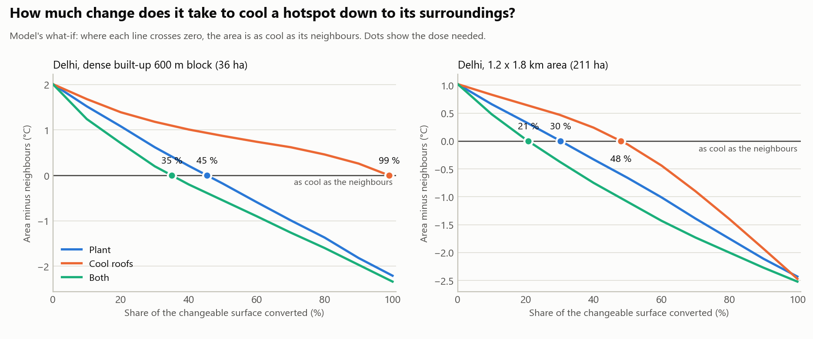
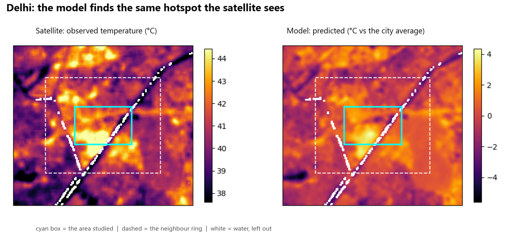
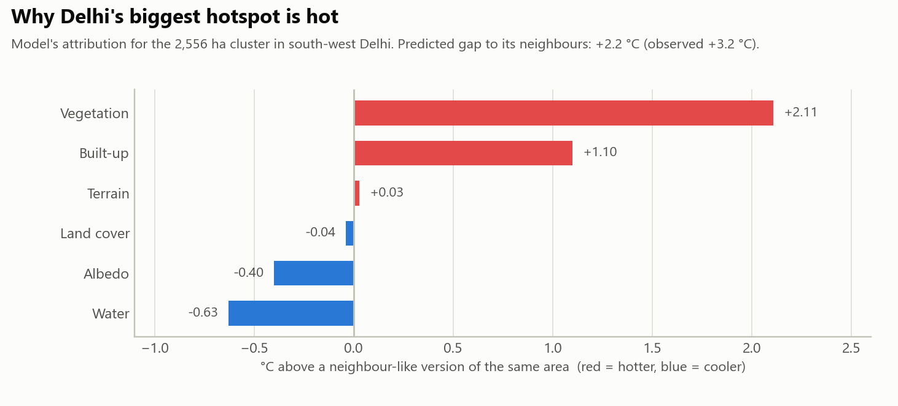
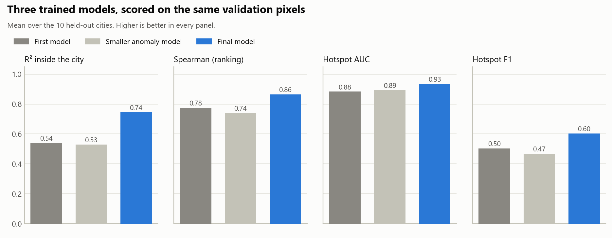
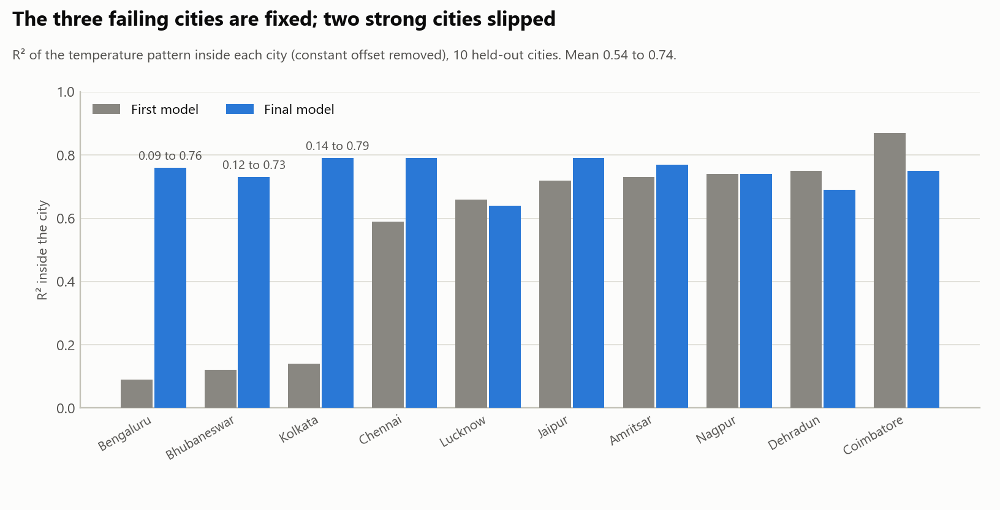
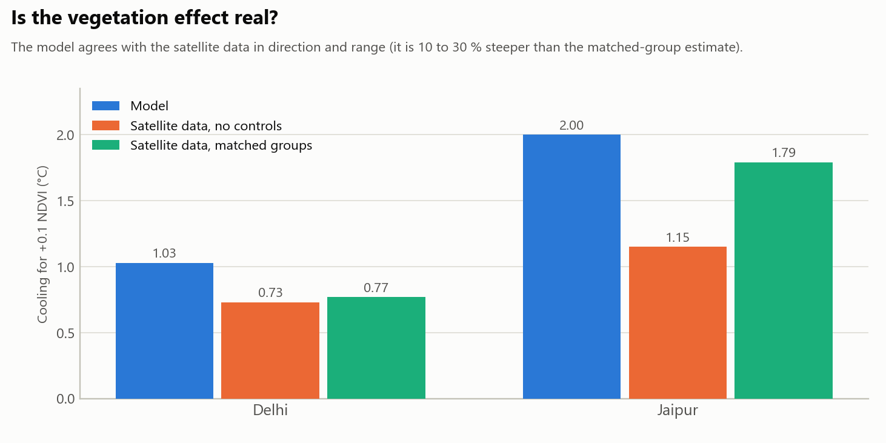
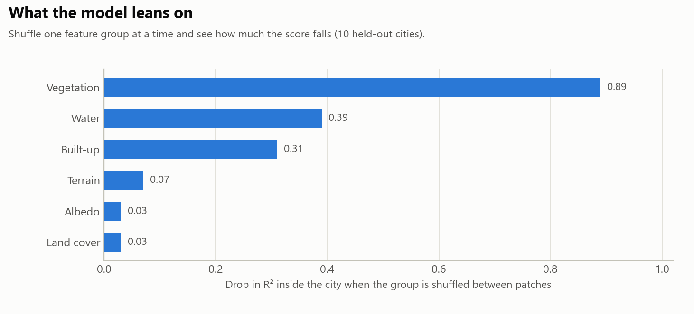

# 🔥 Urban Heat Hotspots for Indian Cities

**Which parts of a city are cooking, why, and how much green would it take to cool them down?**

We built a satellite dataset of 50 Indian cities, trained a U-Net to predict how heat is spread *inside* a city, and turned it into
three tools: a **hotspot finder**, a **"what is driving this heat?" explainer** and a **cooling what-if simulator**.

## The 30-second version

> A dense, built-up 600 m block in Delhi runs **4.5 °C hotter** than the streets around it.
> Our simulator says the gap closes if about **45 % of its open ground is planted** (roughly 15 hectares),
> *or* nearly all its roofs are made reflective, *or* a bit of both (35 % of each).
> About 2.4 °C of the observed gap is heat our data cannot explain (traffic, industry, air conditioning...), and the tool says so out loud.



| | |
|---|---|
| 🛰️ **50 cities**, 30 m pixels | about 89 million pixels, 46 features each |
| 🎯 **R² 0.74** inside the city | on 10 cities the model never saw |
| 🔎 **Hotspot AUC 0.93** | hot pixels ranked above cool ones |
| 🌳 **Cooling doses** | "how much green closes the gap?" for any area you pick |

## Three tools

### 1. Where are the hotspots? `models/hotspot_report.py`
The model predicts the temperature of every pixel, and Getis-Ord Gi\* flags blocks that are *significantly* hotter than the rest of the
city. No "top 10 %" quota: some cities have many hotspots, some have none.



### 2. What is driving them? `models/hotspot_report.py`, `models/group_importance.py`
Features are grouped (vegetation, built-up, albedo, water, terrain, land cover). For each hotspot we swap one group at a time for its
neighbours' average and ask the model again, which gives each group's exact share of the extra heat (Shapley values), in °C.



### 3. What would cool it down? `models/simulate_cooling.py`
Pick an area (draw a box or let it find the worst one). The simulator converts a growing share of it to tree cover and/or reflective roofs,
recomputes every neighbourhood feature, re-predicts, and tells you the dose at which the area is as cool as its surroundings
(the graph at the top).

```
python models/hotspot_report.py --city Delhi
python models/simulate_cooling.py --city Delhi --auto 20 --min-built 0.4
```

| Area | Hotter than neighbours by | What closes the gap (model's view) |
|---|---|---|
| Jaipur, strongest 600 m hotspot | 4.4 °C observed, 2.2 °C seen by the model | plant 40 % of the open pixels (14 ha) |
| Delhi, dense 600 m block | 4.5 °C observed, 2.0 °C seen by the model | plant 45 % (15 ha), or reflective roofs on 99 % of buildings, or 35 % of each |
| Delhi, 1.2 x 1.8 km area | 1.3 °C observed, 1.0 °C seen by the model | plant 30 % (57 ha), roofs 48 % (76 ha), or 21 % of each |

## Try it: the dashboard

An interactive app on top of the same model, with two modes:

- **Anywhere in India (live).** A map of India. **Draw a rectangle** (1 to 10 km a side) on any place and press *Analyse*. The app downloads the
  satellite data for that place (Landsat 8/9, elevation, land cover, buildings), derives the same 46 features as for the 50 trained cities,
  runs the model, and shows whether the area is a hotspot, **what drives it**, and **how much planting or reflective roofing would bring it
  down to the level of its neighbours**. Sliders let you try your own mix.
- **Prepared cities.** The same analysis on the 50 cities processed in advance: instant, no downloads.

```bash
pip install -r requirements-app.txt        # the dashboard's packages, plus PyTorch (pip install torch)
streamlit run dashboard/app.py
```

Everything it needs lives in the [`Deploy/`](Deploy/README.md) folder: `best.pt` (the trained model) and `meta.json` (the feature statistics of
that training run). The prepared-cities mode also needs `grids/<City>_features.nc` + `<City>_temp.nc` (about 200 MB per city).
`python dashboard/check_setup.py` tells you what is still missing.

**How the live mode works, and what it costs.** For a rectangle it processes a window of at least 16 km around it (the model needs the
surroundings), exactly like the prepared cities: `extraction/build_dataset.py` for the data, `pre_processing/export_city_grids.py` for the
derived features. On a fresh Pune area it took about **4 minutes** on a laptop connection (26 Landsat scenes, about 2.5 minutes; building layers,
about 1 minute the first time for a region, then cached); the same rectangle is instant afterwards. We checked the live features against the
original build of the same place: the same 46 features on the same pixel grid, median correlation 0.998 and temperature correlation 1.000
(the 2 km-window features and distance to water differ slightly, as the live window is larger).
Live areas are a little **less reliable** than the prepared cities: fewer scenes are averaged (20 instead of up to 40), and the city-relative
inputs and the hotspot statistics are relative to the window instead of a 40 km city box. It needs internet access (Microsoft Planetary Computer
and the JRC GHSL server) and about 4 GB of RAM, and analyses one area at a time.

## Deploy it (CI/CD)

The repository has a GitHub Actions pipeline, `.github/workflows/ci.yml`:

1. **Test** (every push and pull request): installs the app's packages and runs `python -m unittest discover -s tests`. The tests build a small
   synthetic city, so they need no real data and no internet. They cover the engine, the live-pipeline helpers and the whole Streamlit app
   (draw a rectangle, analyse, results) with Streamlit's test harness.
2. **Build** (push to `main`): builds the container (`Dockerfile`) and pushes it to the GitHub Container Registry.
3. **Deploy** (optional, push to `main`): set the repository variable `DEPLOY_TARGET` to one of

   | `DEPLOY_TARGET` | What it does | You provide |
   |---|---|---|
   | `huggingface` | pushes the app to a Hugging Face Space (Docker SDK), which builds and runs it | variable `HF_SPACE` (`your-name/urban-heat`), secret `HF_TOKEN` (write token) |
   | `azure` | points an Azure Container App at the new image | variables `AZURE_CONTAINER_APP`, `AZURE_RESOURCE_GROUP`; secrets `AZURE_CLIENT_ID`, `AZURE_TENANT_ID`, `AZURE_SUBSCRIPTION_ID` (an app registration with a federated credential for the repository) |

Before the first deploy, put **`Deploy/meta.json`** (from `pre_processing/patches/meta.json` of the training run) in the repository next to
`Deploy/best.pt`; the build stops with a clear message if either is missing. To create the Azure app once:

```bash
az group create -n heat-rg -l centralindia
az containerapp env create -n heat-env -g heat-rg -l centralindia
az containerapp create -n urban-heat -g heat-rg --environment heat-env --image ghcr.io/<owner>/<repo>:latest     --target-port 8501 --ingress external --cpu 2 --memory 4Gi --min-replicas 1
```
(make the package public in GitHub, or add `--registry-server ghcr.io --registry-username <user> --registry-password <token>`). To run the
container yourself: `docker build -t urban-heat .` then `docker run -p 8501:8501 urban-heat`.

## How well does it work?

Scored on **10 cities held out from training** (Jaipur, Lucknow, Nagpur, Chennai, Bengaluru, Kolkata, Bhubaneswar, Dehradun, Amritsar,
Coimbatore), on usable pixels, with each city's mean temperature given (the model predicts the pattern *inside* a city).

| | First model | Final model |
|---|---|---|
| R² inside the city | 0.54 | **0.74** |
| Rank correlation inside the city | 0.78 | **0.86** |
| Hotspot AUC / F1 | 0.88 / 0.50 | **0.93 / 0.60** |
| Cities worse than "every pixel = city average" | 1 | **0** |



### The plot twist

Our first U-Net scored a shiny R² of 0.85 and we nearly stopped there. Then we scored it *inside* each city, and Kolkata turned out
**worse than guessing the city average**, with Bengaluru and Bhubaneswar barely better. Most of that 0.85 was just "Jaipur is hotter than
Dehradun". Chasing it down led to the changes that mattered: giving the model each feature *relative to its own city*, masking pixels with
suspiciously few satellite passes, and a larger network. Those fixed all three cities, although two strong ones (Coimbatore, Dehradun) slipped a little.
(We did not run the ablation that separates the three changes, so we can't say which one did the most.)



### Did the model just make up the vegetation effect?

We checked. For +0.1 NDVI the model predicts a cooling of 1.0 °C in Delhi and 2.0 °C in Jaipur; the satellite data itself, compared across
places with the same land cover, built-up share, elevation and distance to water, shows 0.8 and 1.8 °C. Same direction, same range. The model
is 10 to 30 % steeper, so read the doses as the optimistic end.



It also leans on vegetation heavily: shuffling that group of features drops R² by 0.89, against 0.39 for water, 0.31 for built-up and under 0.1 for the rest.



## Full metrics

<details open>
<summary><b>Final model, city by city</b> (10 held-out cities)</summary>

R² inside the city is shown twice: as scored, and with each city's constant offset removed. "Hot" columns use the hottest 10 % of each city.

| City | MAE (°C) | R² inside | R² offset removed | Spearman | Hot AUC | Hot F1 | Bias on hot pixels (°C) |
|---|---|---|---|---|---|---|---|
| Amritsar | 0.54 | 0.77 | 0.77 | 0.88 | 0.97 | 0.76 | -0.52 |
| Bengaluru | 0.90 | 0.75 | 0.76 | 0.86 | 0.93 | 0.60 | -0.53 |
| Bhubaneswar | 1.00 | 0.70 | 0.73 | 0.90 | 0.93 | 0.58 | -0.18 |
| Chennai | 0.93 | 0.76 | 0.79 | 0.85 | 0.90 | 0.54 | -1.21 |
| Coimbatore | 1.74 | 0.68 | 0.75 | 0.91 | 0.95 | 0.65 | -1.09 |
| Dehradun | 1.96 | 0.67 | 0.69 | 0.86 | 0.94 | 0.61 | -3.99 |
| Jaipur | 0.98 | 0.78 | 0.79 | 0.89 | 0.95 | 0.59 | -1.07 |
| Kolkata | 0.82 | 0.78 | 0.79 | 0.91 | 0.95 | 0.62 | -1.87 |
| Lucknow | 1.23 | 0.64 | 0.64 | 0.74 | 0.92 | 0.56 | -1.83 |
| Nagpur | 1.06 | 0.71 | 0.74 | 0.83 | 0.92 | 0.54 | -1.18 |
| **Mean** | **1.12** | **0.72** | **0.74** | **0.86** | **0.93** | **0.60** | **-1.35** |

MAE is with the city's mean temperature given, so it measures the *pattern* error and is not an absolute-temperature error. The best training
epoch was picked on these same 10 cities, so every score here is slightly optimistic.

</details>

<details>
<summary><b>All trained models, same validation pixels</b></summary>

| Model | Target | Inputs | Epochs | R² inside (offset removed) | Spearman | Hot AUC | Hot F1 | Bias on hot pixels | Cities worse than the city mean |
|---|---|---|---|---|---|---|---|---|---|
| First model | absolute temperature | 45 | 30 | 0.54 | 0.78 | 0.88 | 0.50 | -1.45 °C | 1 |
| Smaller anomaly model | anomaly | 45 | 12 | 0.53 | 0.74 | 0.89 | 0.47 | -2.45 °C | 0 |
| **Final model** | anomaly | 51 | 7 | **0.74** | **0.86** | **0.93** | **0.60** | **-1.35 °C** | **0** |

All three were evaluated on the same patches by `models/compare_runs.py`. The older models use the first 45 of the 51 input channels.

</details>

<details>
<summary><b>Error by land cover</b> (final model)</summary>

| Land cover | Pixels | MAE (°C) | Bias (°C) |
|---|---|---|---|
| Cropland | 6.74 M | 0.92 | +0.04 |
| Tree cover | 4.98 M | 1.37 | +0.43 |
| Built-up | 3.40 M | 1.12 | -0.07 |
| Grassland | 2.13 M | 1.16 | +0.39 |
| Shrubland | 0.36 M | 1.06 | +0.19 |
| Bare / sparse | 0.18 M | 2.21 | -0.83 |
| Wetland | 0.02 M | 1.05 | +0.24 |

</details>

<details>
<summary><b>Hotspot detection quality</b> (Gi* z of at least 2.58, clusters at least 1 °C above their neighbours)</summary>

| | Delhi | Jaipur |
|---|---|---|
| Blocks flagged (600 m blocks) | 11.1 % | 18.9 % |
| Clusters kept after the 1 °C filter | 7 (3.7 % of the city) | 5 (16.0 % of the city) |
| Overlap with hotspots found on the observed temperature: precision / recall / IoU | 0.57 / 0.50 / 0.36 | 0.75 / 0.78 / 0.62 |
| Correlation of block means, observed vs predicted | 0.85 | 0.91 |

Jaipur's flagged area is dominated by two very large zones (the dry outskirts), so it reads as hot regions more than compact hotspots.

</details>

<details>
<summary><b>Data and training facts</b></summary>

| | |
|---|---|
| Cities | 50, each a 40 km box at 30 m (about 1,350 x 1,350 pixels; about 89 million pixels in total) |
| Training table | 10.08 M rows stacked, 9.25 M after cleaning (water and invalid pixels dropped); 42 cities OK, 8 with warnings, 0 bad in the quality audit |
| Features | 46 per pixel, plus 6 city-relative copies in the patches: 51 numeric channels and a land-cover class |
| Patches | 64 x 64 pixels (1.9 km); about 21,000 for training (about 15 % overlap) and about 4,300 for validation (no overlap); 40 training cities, 10 validation cities |
| Model | U-Net, three down-sampling levels, about 2 M parameters, learned land-cover embedding |
| Training | `--base 32 --epochs 7`, batch 64, AdamW with one-cycle learning rate, dropout, weight decay, running average of the weights, half of the patches per epoch, random rotations and flips; on a 4-core CPU |
| Target | pixel temperature minus its city's mean (the "anomaly"), loss on usable pixels only |

</details>

## The honest part

- **Scores are slightly flattering.** The 10 cities also picked the best training epoch. Think "about 0.7", not "0.74".
- **It predicts patterns, not absolute temperature.** It needs the city's average temperature to be supplied, and it needs the whole city grid.
- **Peaks are underestimated** by about 1.35 °C on average (4 °C in Dehradun). The ranking is good, the hottest values come out low.
- **Drivers and doses are the model's attribution, not proof of cause.** Vegetation, built-up share and albedo move together, and real planting
  comes as parks and tree rows, not scattered pixels.
- **Some heat is outside our data.** It shows up as the "not explained" gap.
- **This is land surface temperature** at the Landsat pass (late morning, clear days, March to May), not air temperature or how it feels at night.
- **Huge arid cities (Jaipur) give big hot zones**, not compact hotspots.

<details>
<summary><b>How it works (technical details)</b></summary>

```
Landsat 8/9, DEM, WorldCover, GHSL, weather  ->  extraction/       50 city grids at 30 m, cleaned tables
                                             ->  pre_processing/   feature + temperature grids -> 64x64 patches
                                             ->  models/           U-Net, evaluation, hotspots, drivers, simulator
```

- **Data.** Target: mean land surface temperature of the clearest Landsat 8/9 passes in March to May 2022-2025, cloud-masked. Public sources:
  Landsat Collection 2 Level-2, Copernicus DEM and ESA WorldCover (via Microsoft Planetary Computer), JRC GHSL (building height, built-up
  fraction, population), Open-Meteo weather (tables only).
- **Features.** NDVI, NDBI, MNDWI, albedo, elevation, slope, land cover, building height, built-up fraction, population, distance to water and
  green space, 150 m / 450 m neighbourhood means, and 28 "surroundings" features (window means from 90 m to 2 km, local variation).
- **Patches.** Cities are split whole, never by patch. Statistics come from training cities only. Water, missing values and few-pass pixels are
  masked out of the loss; features are clipped at +-10 standard deviations.
- **Data findings.** A tile-offset bug in the GHSL reader left several cities without building data (fixed). Each pixel averages a different set of
  cloud-free days; blocks with fewer passes are fine, but tiny few-pass groups (Srinagar, Hyderabad, Jammu) are cold outliers, so only those are masked.

</details>

<details>
<summary><b>Run it yourself</b></summary>

Python 3.10, about 32 GB of RAM, `pip install -r requirements.txt` plus PyTorch (`pip install torch`). Developed on a 4-core Azure ML instance; on
Linux you may need `export LD_LIBRARY_PATH=$CONDA_PREFIX/lib:$LD_LIBRARY_PATH`. Data, patches and trained weights are not in the repo.

```bash
# 1. Data (hours, network bound, resumable, all sources public)
python extraction/build_dataset.py --out data/multi_city --workers 4
python extraction/repair_dataset.py --out data/multi_city
python extraction/finalize_dataset.py --src data/multi_city/all_cities_training.csv.gz --no-csv
python extraction/add_context_features.py --root data/multi_city --no-csv
python extraction/check_dataset.py --root data/multi_city

# 2. Pre-processing
python pre_processing/export_city_grids.py --workers 4
python pre_processing/make_patches.py --workers 4
python pre_processing/check_patches.py

# 3. Model
python models/train_unet.py --base 32 --epochs 7 --out data/unet_run3
python models/evaluate_unet.py --run data/unet_run3        # per-city scores and maps
python models/compare_runs.py                              # rank all saved runs on the same pixels
python models/group_importance.py --run data/unet_run3

# 4. Hotspots, drivers, cooling
python models/hotspot_report.py --city Delhi Jaipur
python models/simulate_cooling.py --city Delhi --run data/unet_run3 --box 600 640 1040 1100
```

Smoke test of the data builder on one small box: `python extraction/build_dataset.py --half 8 --cities Pune --out data_test`.

</details>

<details>
<summary><b>What is in the repo</b></summary>

```
extraction/       data pipeline: build_dataset, repair_dataset, finalize_dataset, add_context_features, audits, run_new_cities.sh
pre_processing/   export_city_grids, make_patches, check_patches, pack_patches
models/           train_unet, evaluate_unet, compare_runs, hotspot_report, group_importance, simulate_cooling
dashboard/        Streamlit app: app.py (interface), engine.py (computations), live.py (live satellite pipeline), plots.py, check_setup.py
tests/            unit and app tests (synthetic city, no real data needed)
.github/          CI/CD pipeline (test, build the container, deploy)
Deploy/           what the dashboard runs on: best.pt, meta.json, grids/ (see Deploy/README.md)
notebooks/        data_audit.ipynb
docs/             the figures used in this README
```

The charts in `docs/` were redrawn from the numbers printed by our own evaluation, comparison, importance and simulator runs.
The Delhi map is a crop of a real `simulate_cooling.py` figure.

</details>

## Credits

USGS / NASA Landsat 8 and 9 and Microsoft Planetary Computer; Copernicus DEM GLO-30; ESA WorldCover; European Commission JRC Global
Human Settlement Layer (GHSL R2023A); Open-Meteo (ERA5-based weather). Check each source's licence before reuse.
