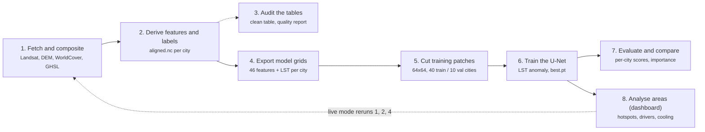

# 03 Methodology: Heat_Map (Urban Heat Hotspots for Indian Cities)

Sources: `01_project_brief.md`, `02_data_inventory.md`, and the code at HEAD `6e20bf7`. Key claims were re-checked against the cited lines. Citations are `[file:line]`. "Inferred" means the repo does not state it directly.

---

## 1. Summary

The project builds a satellite dataset for 50 Indian cities. Each city is a 40 km square on a 30 m grid. It then trains a neural network to predict where a city's ground is hotter or cooler than that city's own average. The temperature is **land surface temperature (LST)**: how hot the ground and roofs are, as measured from space by a thermal sensor. It is not air temperature. The input to the model is around 50 maps per city that describe vegetation, buildings, water, terrain and land cover. The model was trained on 40 cities and scored on 10 other cities. The trained model then drives three tools. A hotspot finder flags areas that are statistically hotter than the rest of the city. A driver explainer splits a hotspot's extra heat across feature groups such as vegetation and built-up. A cooling simulator estimates how much planting or reflective roofing would bring an area down to the level of its neighbours. All three run in a Streamlit dashboard, either on the prepared cities or on any rectangle drawn in India. [README.md:5-6, 24-41, 218-224; models/train_unet.py:8-12]

---

## 2. Pipeline

### 2.1 Stages

1. **Fetch and composite**
   - *What happens:* Clear-sky Landsat 8/9 scenes from March to May 2022-2025 are downloaded for each city, along with elevation, land cover and building layers. Cloudy pixels are removed and the remaining passes are averaged pixel by pixel.
   - *Script:* `extraction/build_dataset.py` (`get_landsat`, `get_dem_and_landcover`, `get_ghsl`, `get_weather`).
   - *In → out:* Planetary Computer STAC, JRC GHSL files, Open-Meteo → in-memory per-city layer stack on a 30 m UTM grid.
   - [extraction/build_dataset.py:138-207, 213-222, 343-375]
2. **Derive features and labels**
   - *What happens:* Spectral indices, slope, neighbourhood averages and distances to water and green are computed. Label layers are added for audits.
   - *Scripts:* `extraction/build_dataset.py` (`add_derived`, `add_labels`); `extraction/repair_dataset.py` rebuilds cities that are missing layers.
   - *In → out:* layer stack → `cities/<City>/aligned.nc`, `meta.json`, and a pixel table (every 3rd pixel).
   - [extraction/build_dataset.py:378-420, 464-480, 530; extraction/repair_dataset.py:8-17]
3. **Audit the tables** (a side branch, not on the model path)
   - *What happens:* The stacked pixel table is cleaned, surroundings features are added to it, and each city gets an OK/WARN/BAD quality grade.
   - *Scripts:* `extraction/finalize_dataset.py`, `extraction/add_context_features.py`, `extraction/check_dataset.py`.
   - *In → out:* `all_cities_training.csv.gz` → `all_cities_clean(_ctx).parquet`, `quality_report.csv`.
   - The U-Net path does not read these tables. No script in `pre_processing/`, `models/` or `dashboard/` reads a parquet file (inferred from search).
   - [extraction/finalize_dataset.py:1-11; extraction/add_context_features.py:1-11; extraction/check_dataset.py:1-15]
4. **Export model grids**
   - *What happens:* For each city, the 46 model input layers, including 28 multi-scale "surroundings" features, are written as one grid, and the temperature as another. Label columns and weather are left out on purpose.
   - *Script:* `pre_processing/export_city_grids.py`.
   - *In → out:* `aligned.nc` → `grids/<City>_features.nc` (46 features), `grids/<City>_temp.nc` (LST, pass count).
   - [pre_processing/export_city_grids.py:1-11, 28-33, 45-54]
5. **Cut training patches**
   - *What happens:* Each city grid is cut into 64 x 64 pixel tiles (1.9 km). Features are standardised with training-city statistics, 6 city-relative copies are added, and unusable pixels are masked. Each city goes whole into either training or validation.
   - *Scripts:* `pre_processing/make_patches.py`; `check_patches.py` (checks); `pack_patches.py` (optional repacking for memory).
   - *In → out:* grids → `patches/{train,val}/<City>.npz`, `patches/meta.json`.
   - [pre_processing/make_patches.py:7-21, 160-167]
6. **Train the U-Net**
   - *What happens:* A U-Net learns to map the 51 feature channels plus land cover to each pixel's temperature anomaly. The epoch with the lowest validation error is kept.
   - *Script:* `models/train_unet.py`.
   - *In → out:* patches → `best.pt`, `metrics.csv`, `val_per_city.csv`.
   - [models/train_unet.py:1-18, 147-230]
7. **Evaluate and compare**
   - *What happens:* The model is scored city by city on the 10 validation cities, compared with earlier models on the same pixels, and probed for which feature groups it relies on.
   - *Scripts:* `models/evaluate_unet.py`, `models/compare_runs.py`, `models/group_importance.py`.
   - *In → out:* `best.pt` + val patches → `eval_per_city.csv`, `eval_by_landcover.csv`, `model_comparison*.csv`, `group_importance.csv`.
   - [models/evaluate_unet.py:1-18; models/compare_runs.py:1-14; models/group_importance.py:1-12]
8. **Analyse areas (dashboard)**
   - *What happens:* The model predicts a whole city or a live window, and the tool flags hotspots, attributes the drivers and simulates cooling for a chosen area.
   - *Scripts:* `models/hotspot_report.py`, `models/simulate_cooling.py`, `dashboard/app.py` with `engine.py`; `dashboard/live.py` reruns stages 1, 2 and 4 for a drawn rectangle.
   - *In → out:* `best.pt`, `meta.json`, grids → hotspot clusters, driver bars, dose curves (CSV/PNG, or dashboard views).
   - [models/hotspot_report.py:1-23; models/simulate_cooling.py:1-17; dashboard/engine.py:1-12; dashboard/live.py:1-16, 83-124]

### 2.2 Mermaid flowchart



### 2.3 JSON for an SVG diagram

The order is linear (1→2→4→5→6→7, with 6→8). Stage 3 is a side branch off stage 2, and the frontend can draw it offset.

```json
[
  {"id": 1, "label": "Fetch and composite", "sublabel": "Landsat 8/9 Mar-May 2022-25, DEM, WorldCover, GHSL", "script": "extraction/build_dataset.py"},
  {"id": 2, "label": "Derive features and labels", "sublabel": "indices, neighbourhoods, distances -> aligned.nc", "script": "extraction/build_dataset.py, extraction/repair_dataset.py"},
  {"id": 3, "label": "Audit the tables", "sublabel": "side branch: clean table, quality report", "script": "extraction/finalize_dataset.py, extraction/add_context_features.py, extraction/check_dataset.py"},
  {"id": 4, "label": "Export model grids", "sublabel": "46 features + LST per city, 30 m", "script": "pre_processing/export_city_grids.py"},
  {"id": 5, "label": "Cut training patches", "sublabel": "64x64 px, 51 channels, 40 train / 10 val cities", "script": "pre_processing/make_patches.py"},
  {"id": 6, "label": "Train the U-Net", "sublabel": "predicts LST minus city mean", "script": "models/train_unet.py"},
  {"id": 7, "label": "Evaluate and compare", "sublabel": "10 held-out cities, R2, Spearman, AUC", "script": "models/evaluate_unet.py, models/compare_runs.py, models/group_importance.py"},
  {"id": 8, "label": "Analyse areas (dashboard)", "sublabel": "Gi* hotspots, Shapley drivers, cooling doses", "script": "models/hotspot_report.py, models/simulate_cooling.py, dashboard/app.py"}
]
```

---

## 3. Data sources

| Source | What it provides | Resolution | Period | Access |
|---|---|---|---|---|
| Landsat 8/9 Collection 2 Level-2 (`landsat-c2-l2`) | Thermal band → LST (the target). Six reflectance bands → NDVI, NDBI, MNDWI, albedo. QA band → cloud mask | 30 m grid | Mar-May, 2022-2025; up to 40 clearest scenes per city | Microsoft Planetary Computer STAC |
| Copernicus DEM GLO-30 (`cop-dem-glo-30`) | Elevation, from which slope is computed | 30 m | static | Planetary Computer |
| ESA WorldCover (`esa-worldcover`) | Land-cover class (11 codes, 80 = water) | 10 m product, resampled to 30 m by majority (mode) | 2021 | Planetary Computer |
| JRC GHSL R2023A | Building height (2018), built-up surface (2020), population (2020) | 3 arcsec (~90 m), resampled to 30 m | 2018 / 2020 | Direct download from the JRC FTP server |
| Open-Meteo archive (ERA5-based) | Air temperature, humidity, wind, sunlight and rain around the overpass hours | one value per city | scene dates | Public API, no key |
| OpenStreetMap (optional `--osm`) | Building, water and green fractions | 30 m | current | `osmnx` |

[extraction/build_dataset.py:104-112, 150-153, 178-190, 216-222, 247, 285-339, 343-375, 527-529; README.md:248-250, 316-317]

**Weather and OSM are not model inputs.** The Open-Meteo values are stored as city-level constants in the tables and never reach the U-Net. The grid exporter states "no weather". The OSM layers are optional and are not in the model's feature list. Google Earth Engine is not used. [pre_processing/export_city_grids.py:11, 28-33; README.md:250 "(tables only)"; 01_project_brief.md §3]

Definitions:
- **NDVI** (vegetation index) is (near-infrared − red) / (near-infrared + red). It is higher where plants are green and dense. [extraction/build_dataset.py:187]
- **NDBI** and **MNDWI** are similar band ratios that highlight built-up surfaces and water. [extraction/build_dataset.py:188-189]
- **Albedo** is the share of incoming sunlight a surface reflects. Bright roofs have high albedo and dark asphalt has low albedo. Here it is a weighted sum of five Landsat bands. The weights look like a standard published formula, but the repo does not name it (inferred). [extraction/build_dataset.py:190]

---

## 4. Preprocessing

**Cloud masking.** In every scene, a pixel is dropped if the Landsat quality band flags it as fill, cloud, dilated cloud, cirrus or cloud shadow (bits 0-4). Scenes are searched under a per-city cloud-cover limit of 10-30 % and sorted from clearest. At least 4 scenes are required. [extraction/build_dataset.py:150-158, 181; extraction/build_dataset.py:50-101]

**Scene compositing.** The scenes are loaded in batches of 8. For each pixel, the code keeps a running sum and count of the clear values, then divides to get the mean LST, NDVI, NDBI, MNDWI and albedo over all clear passes. It also stores the LST standard deviation and the number of clear passes (`n_obs`). A pixel with fewer than 5 clear passes is set to missing. Different pixels may therefore average different days, and the README says this openly. [extraction/build_dataset.py:160-207; README.md:255-256]

**Feature engineering.** The model sees 46 features per pixel, plus 6 city-relative copies:
- **Surface (4):** NDVI, NDBI, MNDWI, albedo.
- **Terrain (2):** elevation, slope.
- **Land cover (1):** the WorldCover class. The model learns a small 4-number code for each class.
- **Urban form (3):** GHSL building height, built-up fraction, population.
- **Distances (2):** distance to water (MNDWI > 0.1 or WorldCover water) and to green (NDVI > 0.4), in metres.
- **Neighbourhood means (6):** NDVI, built-up and height averaged over 150 m and 450 m windows.
- **Surroundings (28):** NDVI, NDBI, albedo, MNDWI, built-up fraction and height averaged over windows 90 m, 330 m, 930 m and 2,010 m wide (6 × 4 = 24), plus the local variation of NDVI and built-up at 330 m and 930 m (4). The widest window is the "2 km surroundings". Missing pixels are ignored in these averages.
- **City-relative copies (6, added in the patches):** NDVI, NDBI, albedo, built-up, height and elevation, each re-expressed against its own city: (value − city mean) / city spread. The spread is floored at a quarter of the training-wide spread. These let the model tell "greener than this city's average" apart from "green in absolute terms". The README credits them, together with two other changes, for fixing the cities where the first model failed.

[pre_processing/export_city_grids.py:28-33; extraction/build_dataset.py:378-400; extraction/add_context_features.py:24-48; pre_processing/make_patches.py:36-37, 42-45, 91-96; README.md:125-129, 220, 251-252]

**Patching.**
- **Tiles.** City grids (about 1,350 × 1,350 px) are cut into 64 × 64 px tiles. Training tiles overlap by 15 %. Validation tiles do not overlap, so neighbouring tiles cannot inflate the scores.
- **Usable pixels.** A pixel counts as usable when its LST and every feature are present, it is not water, and it is not a "few-pass" pixel.
  - A few-pass pixel has fewer than 0.6 × the city's median number of passes.
  - This rule is applied only in cities where such pixels are at most 3 % of the total. Srinagar, Hyderabad and Jammu are named as affected.
  - Training also ignores pixels outside 0-75 °C.
- **Dropped tiles.** Tiles with less than 50 % usable pixels are dropped.
- **Standardisation.** Feature means and spreads come from training cities only. Values beyond ±10 spreads are clipped.
- **Counts.** About 21,000 training tiles and 4,300 validation tiles.

[pre_processing/make_patches.py:12-17, 80-89, 103-105, 125-130, 143-154; models/train_unet.py:46, 62; README.md:221, 253-256]

---

## 5. Model

**What it predicts.** For each pixel, the model predicts its **LST anomaly**: the pixel's temperature minus the mean temperature of its whole city. In training, the mean is taken over usable pixels. The code gives the reason: the model learns "where a city is hotter or cooler than its own average, which is what a hotspot is". A city's overall temperature depends on its climate and on the scene dates, which the input maps cannot capture well. The README shows that a model predicting absolute temperature scored a high pooled R² of 0.85 mostly by learning that "Jaipur is hotter than Dehradun", while doing poorly inside some cities. To get a temperature in °C, the observed city mean is added back, so the model on its own cannot give a city's absolute temperature. [models/train_unet.py:8-12, 53-59; README.md:125-127, 231; models/hotspot_report.py:8, 179-181]

**Architecture.** A **U-Net** is a convolutional neural network shaped like a "U". It first shrinks an image step by step to capture wider context, then expands it back to full size. Skip connections carry fine detail across, so it outputs one value per pixel. This one works as follows:
- Three shrinking levels and a bottleneck, with 32/64/128/256 channels.
- Each level uses two 3 × 3 convolutions with normalisation.
- A little dropout in the deeper layers.
- Land cover enters through a learned 4-number code per class.
- About 2 million weights in total: 1.94 M when counted from `Deploy/best.pt`.

[models/train_unet.py:65-97; README.md:222-223; 01_project_brief.md §7.12; 02_data_inventory.md (b)]

**Training setup.**
- **Loss.** Huber loss on standardised anomalies, usable pixels only. Huber loss is an error measure that is less sensitive to outliers than squared error.
- **Optimiser.** AdamW with learning rate 2e-3 and weight decay 1e-2, on a one-cycle learning-rate schedule.
- **Batches and epochs.** Batch size 64. Each epoch uses a random half of the training tiles.
- **Augmentation.** Random 90° rotations and flips.
- **Regularisation.** Dropout 0.1 and a running average of the weights (EMA, decay 0.998). The averaged weights are the ones validated and saved.
- **Final run.** `--base 32 --epochs 7` on a 4-core CPU. The code defaults (base 16, 12 epochs) differ.
- **Model selection.** After each epoch the model is checked on every second validation tile, and the epoch with the lowest validation MAE (mean absolute error, the average size of the error in °C) is saved.

[models/train_unet.py:147-230, 100-115, 205; README.md:223, 280]

**Split by whole city.** Of the 50 cities, 40 are used for training and 10 for validation: Jaipur, Lucknow, Nagpur, Chennai, Bengaluru, Kolkata, Bhubaneswar, Dehradun, Amritsar and Coimbatore. The code describes them as "spread over climates; the hardest cities stay in training". Because no tile from a validation city is ever used for training, the scores measure how well the model transfers to an unseen city, not to an unseen corner of a city it has already seen. [pre_processing/make_patches.py:20, 38-39; README.md:111-112, 221, 253]

**Models compared.** Three models are compared:
- First model: absolute target, 45 inputs, 30 epochs.
- Smaller anomaly model: anomaly target, 45 inputs, 12 epochs.
- Final model: anomaly target, 51 inputs, 7 epochs.

There is no non-neural baseline such as a random forest, and no ablation to separate the effect of the three changes. [README.md:129, 174-180; 01_project_brief.md §5]

---

## 6. Evaluation

All scores are per validation city, on usable pixels. For the anomaly model, the city's true mean is added back before scoring, so the scores measure how well the model gets the **pattern inside the city**. [models/evaluate_unet.py:7-18, 131-132; README.md:111-112, 166]

| Metric | Plain meaning | What "good" looks like | Final model, mean of 10 cities |
|---|---|---|---|
| **MAE** (°C) | Average size of the pixel error, with the city mean given | Lower is better. Compared with the "every pixel = city mean" guess through *skill* = 1 − MAE / that guess's MAE; above 0 beats the guess | 1.12 °C |
| **R²** (inside the city) | **R²** is the share of the temperature variation within a city that the model explains: 1 is perfect, 0 is no better than predicting the city mean everywhere, and below 0 is worse. Two versions exist: "as scored" (`R2_within`), and "offset removed" (`R2_anomaly`), which ignores a constant shift across the whole map | Closer to 1 is better | 0.72 as scored; 0.74 offset removed (the headline) |
| **Spearman** | **Spearman rank correlation** checks whether the pixels the model ranks hotter are really hotter, ignoring exact values. 1 is perfect order and 0 is no relation | Closer to 1 is better | 0.86 |
| **Hotspot AUC** | True hotspot = the hottest 10 % of the city's pixels. **AUC** is the probability that a randomly chosen true-hot pixel is ranked above a randomly chosen other pixel | 0.5 = random, 1 = perfect | 0.93 |
| **Hotspot F1 / IoU** | Overlap between the predicted hottest 10 % and the true hottest 10 % | 1 = identical sets. Random would give about 0.10 (inferred from the 10 % share) | F1 0.60 (IoU is computed but not reported) |
| **Bias on hot pixels** (°C) | Mean error on the truly hottest pixels | 0 is ideal; negative means peaks come out too low | −1.35 °C (−3.99 °C in Dehradun) |
| Error by land cover | MAE and bias for each WorldCover class | n/a | from 0.92 °C (cropland) to 2.21 °C (bare) |

[models/evaluate_unet.py:44-63, 138-141; README.md:150-166, 187-195]

Other checks:
- **Gi\* hotspot overlap.** For Delhi and Jaipur, Gi\* hotspots (section 7) found on the predicted map are compared with Gi\* hotspots found the same way on the observed map. Delhi: precision 0.57, recall 0.50, IoU 0.36. Jaipur: 0.75 / 0.78 / 0.62. [models/hotspot_report.py:205-212; README.md:202-207]
- **Vegetation sanity check.** The model's predicted cooling for +0.1 NDVI is compared with the slope seen directly in the satellite data, within groups of similar land cover, built-up share, elevation and distance to water. Model 1.0 / 2.0 °C against satellite 0.8 / 1.8 °C (Delhi / Jaipur), so the model is 10-30 % steeper. [models/hotspot_report.py:214-234; README.md:135-137]
- **Group permutation importance.** Each feature group is shuffled between tiles of the same city and the drop in score is recorded. Vegetation drops R² by 0.89, water by 0.39, built-up by 0.31, and the rest by under 0.1. This shows what the model relies on, not what causes heat. [models/group_importance.py:1-12; README.md:141]

**Honest caveat on the validation cities.** The 10 validation cities were never used to fit the model's weights, but they were used to **pick the best training epoch**, and `compare_runs.py` uses them to rank the models. They are held out from training, but they are not a fully untouched test set, so the scores are slightly optimistic. The authors themselves say "think about 0.7, not 0.74". There is a single split and a single training run, and no confidence intervals are reported. Note that the README headline "R² 0.74 inside the city" is the offset-removed version; the as-scored mean is 0.72. [README.md:20, 164-167, 230; models/evaluate_unet.py:17-18; models/compare_runs.py:14]

---

## 7. How the tool finds hotspots, explains them and simulates cooling

**Whole-city prediction.** The model predicts every pixel in tiles of 512 px with a 32 px overlap margin, and the observed city (or window) mean is added back. [models/hotspot_report.py:64-73, 193]

**Hotspot detection (Getis-Ord Gi\*).** **Getis-Ord Gi\*** is a spatial statistic. It gives a z-score for whether a location and its immediate neighbours together are significantly hotter than the whole area. The tool works as follows:
1. It averages the predicted temperature into blocks of 20 × 20 px (600 m). Live windows use 10 × 10 px (300 m). Blocks need at least 50 % usable pixels.
2. It computes Gi\* over each block's 3 × 3 block neighbourhood.
3. It flags blocks with z ≥ 2.58 (99 % confidence; the dashboard slider offers 1.645 to 3.29). The docstring still says 1.96, but the code default is 2.58.
4. It joins touching flagged blocks into clusters of at least 2 blocks.
5. It keeps a cluster only if its predicted temperature is at least 1 °C above a 900 m ring of neighbours, with other hotspots excluded from the ring.

There is no fixed quota, so a city can have many hotspots or none. [models/hotspot_report.py:9-11, 76-90, 113-120, 249-252, 328-336; dashboard/app.py:167, 270, 281; README.md:27-28]

For any area, the tool reports three gaps against the neighbour ring:
- **observed gap:** from the satellite.
- **predicted gap:** from the model.
- **not explained:** the observed gap minus the predicted gap, i.e. heat the input data cannot account for, such as traffic, industry or air conditioning, plus noise. [models/hotspot_report.py:258-261; dashboard/app.py:441-445]

**Driver attribution (Shapley values).** **Shapley values** come from game theory. They split a total effect fairly among several contributors by averaging each contributor's effect over every possible combination of the others. The features fall into 6 groups: vegetation, built-up, albedo, water, terrain and land cover. For each of the 2⁶ = 64 combinations, the groups left "off" have their values inside the area replaced by the neighbour ring's average (for land cover, the ring's most common class), and the model predicts again. Each group's exact Shapley value is then reported in °C, above "a neighbour-like version" of the area. The parts add up as: observed gap = sum of groups + reference mismatch + not explained. The dashboard runs the same routine on the user's rectangle. These are the model's attributions, not proven causes, because vegetation, built-up share and albedo tend to move together. [models/hotspot_report.py:14-17, 44-61, 93-101, 127-142; dashboard/engine.py:198-200; README.md:233-234]

**Cooling simulation ("doses").** The area is the user's rectangle, or with `--auto` the block whose observed LST stands out most from its ring. The neighbours are a ring 900 m wide by default (150-1,500 m slider in the dashboard). There are two levers:
- **Vegetation.** Applies to non-water pixels with NDVI < 0.4 and built fraction < 0.6. A converted pixel takes the city's median NDVI, NDBI, MNDWI and albedo of its tree pixels, and its land cover becomes "tree".
- **Cool roofs.** Applies to built pixels (WorldCover built-up, or built fraction ≥ 0.3). A converted pixel's albedo rises by 0.15, capped at 0.6. The lever is marked "not applicable" when an area has fewer than 30 such pixels.

A **dose** is the share (0-100 %) of eligible pixels converted. Pixels are taken in a random but fixed order (seed 0), and the dose runs for each lever alone and for both together. After every step:
1. The neighbourhood, surroundings, distance-to-green and city-relative features are recomputed the same way as in the dataset build.
2. The model predicts again.
3. The area's mean is compared with the ring's mean.

The dose that closes the gap is found by linear interpolation. The result is "not enough" if 100 % does not close it. Results are given in % and in hectares (0.09 ha per pixel). A stricter target, bringing the hottest 10 % of the area down to the ring's level, is also reported. [models/simulate_cooling.py:1-17, 88-155, 160-173, 240-252, 305-321; dashboard/app.py:169, 418]

**Dashboard verdict.**
- "Not hotter than its neighbours" if the predicted gap is ≤ 0.2 °C.
- "A hotspot" if the gap is ≥ 1 °C and at least 50 % of the area lies in Gi\* hot blocks.
- Otherwise "warmer" or "only slightly warmer".

[dashboard/app.py:425-437]

**Live mode.** The user draws a rectangle of 1-10 km per side, centred inside India's bounding box. The app processes a square window around it, at least 16 km wide with a 3 km margin. For that window it reruns stage 1 (fetch and composite), stage 2 (derive features) and stage 4 (export grids):
- 20 Landsat scenes by default (adjustable 8-40).
- The Landsat cloud limit is relaxed in steps from 20 % to 40 % to 70 %.
- The same months and years as training.

The city-relative features and the Gi\* statistics are computed relative to the window, and the code flags live results as somewhat less reliable for that reason. [dashboard/live.py:1-16, 31-36, 48-68, 83-124; dashboard/app.py:171]

---

## 8. Infrastructure (as the repo shows it)

- **Compute for the pipeline: an Azure ML compute instance (inferred).** The README says the project was "developed on a 4-core Azure ML instance" with about 32 GB RAM. The batch script falls back to the conda environment `/anaconda/envs/azureml_py38`, which is the default environment on Azure ML compute instances. `Deploy/README.md` says the model and grids come from paths "on the Azure VM". The repo does not include job definitions or a workspace config, so it is inferred that the pipeline ran interactively on that instance. Training ran on CPU. [README.md:223, 263; extraction/run_new_cities.sh:17-18; Deploy/README.md:7-9]
- **No Azure Storage.** No code or requirements file uses an Azure storage account, blob container, `abfs://` or `wasb://` path, connection string or Azure SDK. All scripts read and write plain files under repo-relative folders (`data/`, `pre_processing/`). Data, patches and weights are gitignored, and only `Deploy/best.pt` is committed. The only "SAS" tokens in the code are Planetary Computer's own short-lived public signing tokens. [01_project_brief.md §9; 02_data_inventory.md (a); .gitignore:1; extraction/build_dataset.py:161-176]
- **Docker.**
  - Image based on `python:3.12-slim`, with CPU-only PyTorch 2.5.1 and the app requirements.
  - Copies the code and `Deploy/`, and serves Streamlit on port 8501 with a health check.
  - Needs about 4 GB RAM and internet access for live mode.
  - [Dockerfile:1-24]
- **GitHub Actions CI.** It runs on every push and pull request. It does a syntax check, then unit and app tests on a synthetic 200 × 200 px city with an untrained model, with no real data and no network. [.github/workflows/ci.yml:12-40; tests/synthetic.py:1-6]
- **GHCR.** On `main`, the `image` job checks that `Deploy/best.pt` and `Deploy/meta.json` exist, then builds and pushes `ghcr.io/<repo>:latest` and `:<sha>`. `Deploy/meta.json` is currently missing from the repo, so this job would fail as things stand. [.github/workflows/ci.yml:42-71; 02_data_inventory.md (b)]
- **Optional deploy.** The repository variable `DEPLOY_TARGET` picks one of two targets:
  - `huggingface`: pushes a Docker Space.
  - `azure`: OIDC login, then `az containerapp update` on an Azure Container App. The README gives a one-time setup: resource group `heat-rg` in `centralindia`, app `urban-heat`, 2 CPU / 4 GiB.
  - [.github/workflows/ci.yml:73-113; README.md:91-105]

---

## 9. Assumptions and limitations

1. **Surface, not air.** The target is land surface temperature at the Landsat pass: late morning, clear days, March to May. It is not air temperature, night-time heat or how hot it feels. [README.md:236; models/hotspot_report.py:21-22]
2. **Pattern, not level.** The model predicts each pixel relative to its city's mean. The observed mean must be supplied, and the model needs the whole city grid or a large window around the area. [README.md:231]
3. **Slightly optimistic scores.** The validation cities also chose the epoch and ranked the models. There is one split, one seed and no confidence intervals. The 10 validation cities were picked by hand, with "the hardest cities" kept in training. [README.md:167, 230; pre_processing/make_patches.py:39]
4. **Peaks come out low.** On the truly hottest pixels the error averages −1.35 °C, and −4 °C in Dehradun. The model ranks hot areas well but underestimates how hot they are. [README.md:232]
5. **Attribution is not causation.** Drivers and doses show what the model learned. Vegetation, built-up share and albedo are correlated because they come from the same satellite bands, and the model leans heavily on vegetation. [README.md:233-234; models/group_importance.py:9-11]
6. **Doses lean optimistic.** The model's vegetation effect is 10-30 % steeper than the satellite estimate. The simulation also converts scattered pixels to the city's median tree values, whereas real planting comes as parks and tree rows. Cool roofs are modelled only as a +0.15 albedo change. [README.md:137, 234; models/simulate_cooling.py:111-114]
7. **Unexplained heat.** Heat sources not in the data, such as traffic, industry and air conditioning, appear only as the "not explained" gap. [README.md:13, 235]
8. **Arid cities.** Very large arid cities like Jaipur give broad hot zones, mostly dry outskirts, rather than compact hotspots. [README.md:209, 237]
9. **Input dates differ.** LST covers 2022-2025, land cover is from 2021, and the GHSL layers are from 2018 and 2020. Change in a fast-growing area can be missed (inferred). [extraction/build_dataset.py:107-112, 220, 527]
10. **Uneven compositing.** Each pixel averages its own set of clear days, and only small few-pass groups are masked. [README.md:255-256]
11. **Live mode is weaker.** It averages fewer scenes, and its "city" is the processing window, not a 40 km city box. [dashboard/live.py:13-16; README.md:79-80]
12. **Three different "hotspot" definitions.**
    - The tool uses Gi\* clusters.
    - The evaluation metrics (AUC 0.93, F1 0.60) use the hottest 10 % of pixels.
    - The dataset's `HOTSPOT` label uses the hottest 10 % of urban pixels and is only used in audits.
    - [models/hotspot_report.py:9-11; models/evaluate_unet.py:14-15; extraction/build_dataset.py:417-419]
13. **Narrow model comparison.** There is no non-neural baseline and no ablation. Weather, OSM layers and the 3 km spatial blocks prepared for cross-validation are not used by the U-Net. [README.md:129; pre_processing/export_city_grids.py:11; extraction/build_dataset.py:12-13]
14. **Limited traceability.** No metrics CSVs, logs or training `meta.json` are committed, and the `docs/` figures were "redrawn from the numbers printed" by the runs. All result numbers come from the README and the figures. [README.md:309-310; 01_project_brief.md header]

---

## 10. Open questions for the author

1. The headline "R² 0.74 inside the city" is the offset-removed mean (`R2_anomaly`); the as-scored mean is 0.72. Which one, and which label, should the dashboard show?
2. Since the 10 validation cities also picked the best epoch and ranked the models, can we describe them as "held out from training, used for model selection" instead of "cities the model never saw" (`README.md:20`)?
3. Which metric showed Kolkata as "worse than the city average" for the first model? Can you share the per-city table for the first and smaller models?
4. Were the README cooling doses and `fig_cooling_curves.png` produced with the final model (`data/unet_run3`)? `simulate_cooling.py` defaults to `data/unet_run2`. And is `Deploy/best.pt` that same checkpoint?
5. The Gi\* docstring says z = 1.96 but the code default is 2.58. Is 2.58 the intended setting for all published results?
6. Which definition should the dashboard call a "hotspot": Gi\* clusters (the tool), or the hottest 10 % of pixels (behind AUC 0.93 and F1 0.60)?
7. For the Delhi example, is the "~2.4 °C not explained" computed from unrounded values (4.5 − 2.0 would give 2.5)? What are the coordinates and settings of the 2,556 ha cluster in the drivers figure?
8. The live-mode Pune test used 26 Landsat scenes, but the default is 20. Was `max_scenes` raised for that test?
9. Can you add `Deploy/meta.json`, from the same run as `best.pt`? CI and the dashboard cannot run without it.
10. Can you share the raw outputs (`eval_per_city.csv`, `metrics.csv`, `model_comparison*.csv`, `group_importance.csv`, `*_hotspots.csv`, `sim_*.csv`, `patch_summary.csv`, `quality_report.csv`), including RMSE, skill and IoU, which are computed but not reported?
11. Which epoch was selected as best in the final run? Are the epoch counts in the README (30, 12, 7) epochs run or epochs selected? What were the earlier models' base width and learning rate?
12. What are the exact training and validation tile and pixel counts, and which 8 cities got warnings in the quality audit?
13. Is the land-cover error table from the validation cities? Were classes like snow, mangrove and moss absent because they had zero pixels?
14. Which Python and package versions were used for training: README says 3.10, Docker and CI use 3.12, and `requirements.txt` pins very recent versions?
15. Was any leave-one-city-out or spatial-block cross-validation ever run, given that `block_id` is built but unused?
16. Which cities were judged "hardest" and kept in training, and could that choice make the validation scores look better?
17. Were multiple seeds or splits ever tried, so that some spread or uncertainty could be reported?
18. What settings (z, block size, run) produced the vegetation-check values (1.03 / 0.73 / 0.77 and 2.00 / 1.15 / 1.79)?
19. Where do the full datasets (`data/`, `pre_processing/grids/`, `patches/`) live now: still on the Azure ML instance's disk? Can the small CSV outputs be exported?
20. Is there an audit of the full 50-city table? The notebook covers only the original 14 cities and a smoke-test run.
